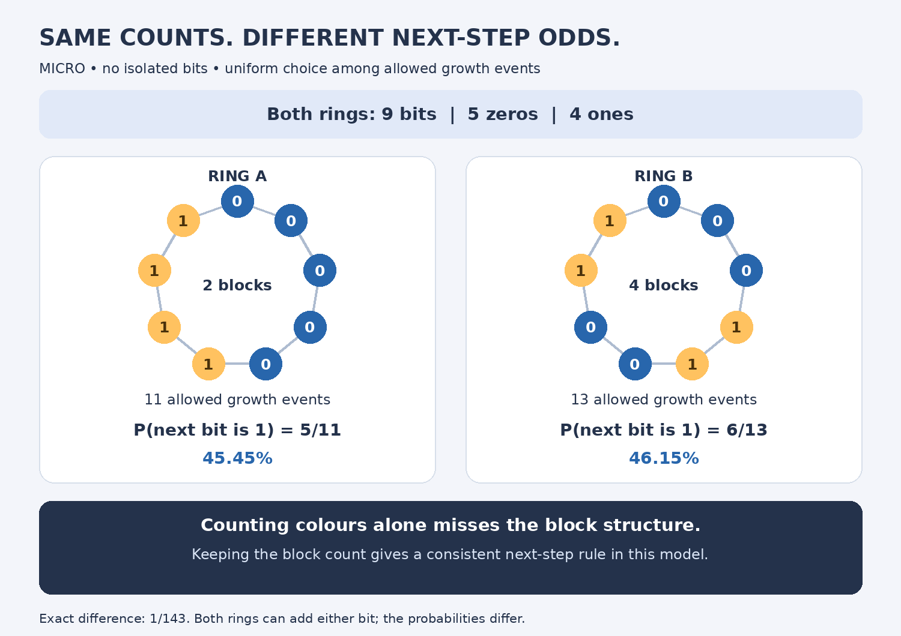
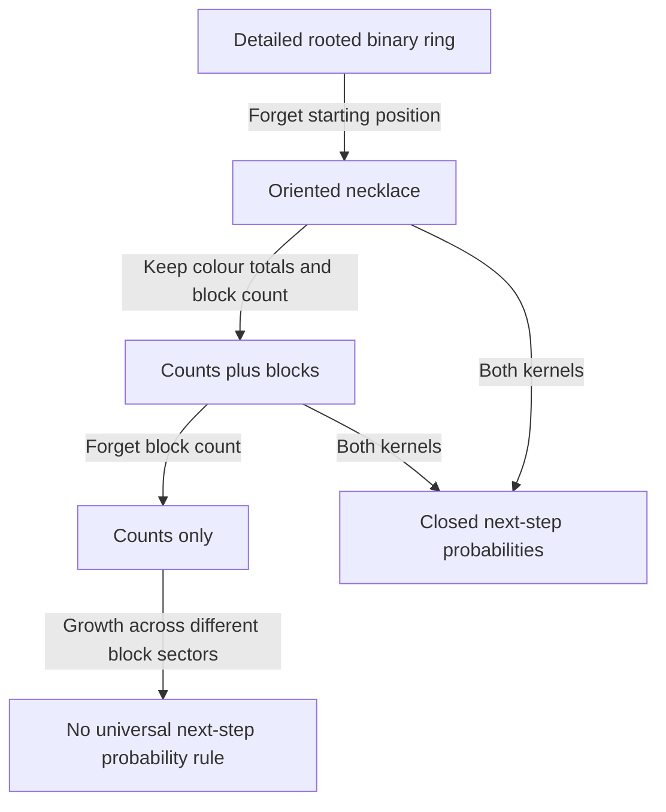

# EHF observer compatibility audit 01

28 October 2026 · Exact tests on a specified binary no-isolation model

## Result in plain language

Forgetting where a ring starts is harmless for the two rotation-symmetric update rules tested. Forgetting the arrangement while retaining colour counts and block count also gives a closed next-step description. Forgetting the block count can change the next-growth probabilities even when the colour totals agree.

The distinction is between possible outcomes and their probabilities: all three observers passed the one-step reachable-outcome test in this census, but the counts-only observer failed the probability test under growth.

## Precisely specified model

States are rooted binary words on a cyclic ring, of length n>=4. No cyclic triple may be 010 or 101. Equivalently each bit has a same-colour neighbour, and every nonuniform monochromatic run has length at least two. Both homogeneous rings are allowed.

We study two separate discrete-time kernels:

1. **LR3:** reverse a contiguous cyclic length-three block. Retain moves whose output is admissible and changes the binary word. Choose uniformly among these events, including distinct events that happen to give the same resulting word. If none exists, use a self-loop.
2. **Growth:** choose uniformly among admissible pairs `(cyclic edge, inserted bit)`. Inserting 0 or 1 must preserve no-isolation. Distinct events are counted separately even if their rooted output words coincide.

These are deliberately specified kernels for this audit. They are not asserted to reproduce every historical MICRO experiment. We do not include LR4, ambient-graph restrictions, material vertex identities, continuous-time rates, or state-dependent mixtures of the two kernels.

## Three observers

| Observer | What it retains | What it discards |
|---|---|---|
| Necklace | Full oriented cyclic binary pattern up to rotation | Choice of starting position |
| Counts and blocks | Length n, number k of ones, number of monochromatic cyclic blocks | Block lengths and their cyclic arrangement |
| Counts only | n and k | All arrangement information, including block count |

Reflection and exchanging the two colours are not included in the necklace equivalence. Homogeneous words are recorded as having one block; their number of colour-change boundaries is zero.

## What compatibility means

For a state x, an observer pi and a transition kernel K, calculate the exact distribution

    P_x(b) = sum_{y: pi(y)=b} K(x,y).

The observer has a preparation-independent Markov transition rule (strong lumpability) if P_x=P_x' whenever pi(x)=pi(x'). We compare the full distributions, not just average values. We separately compare their supports, the sets of possible next observations.

The kernel is needed: an admissibility relation alone does not specify probabilities.

## Census

The program exhaustively enumerates admissible rooted words for every n from 4 through 14, totalling 2,198 states across the eleven sizes. All distributions use exact rational arithmetic. Growth targets reach size 15.

| Observer | LR3 probability test | Growth probability test | Reachable-outcome support test |
|---|---|---|---|
| Necklace | PASS | PASS | PASS |
| Counts and blocks | PASS | PASS | PASS |
| Counts only | PASS | FAIL, first at n=9 | PASS |

Counts-only LR3 closure is a limited statement: the observation never changes, because LR3 preserves colour counts. It does not imply that this observer captures transport or mixing.

## Explicit counterexample

The two cyclic words below have five zeros and four ones:

| Quantity | Ring A | Ring B |
|---|---|---|
| Rooted representative | 000001111 | 000110011 |
| Run lengths, starting with zero | 5,4 | 3,2,2,2 |
| Block count | 2 | 4 |
| Admissible growth events | 11 | 13 |
| Events inserting 1 | 5 | 6 |
| Probability of inserting 1 | 5/11 | 6/13 |
| Probability of inserting 0 | 6/11 | 7/13 |

The difference between the probabilities of inserting 1 is exactly 1/143, about 0.6993 percentage points. Both states can insert either bit, so this example distinguishes probabilities, not possible outcomes.

## Analytic explanation and closure

Let b be the number of edges joining opposite colours. For a nonuniform ring, b is also its number of blocks, and b is even. In a homogeneous ring b=0.

At an equal-colour edge there is exactly one legal insertion: the same colour. The opposite colour would be isolated. At an opposite-colour edge, either insertion extends one of its two existing blocks and is legal. Therefore the total number of admissible events is

    n+b.

There are k-b/2 edges joining two ones and b mixed edges, so the number of legal one-insertions is

    k+b/2.

Consequently

    P(insert 1 | n,k,b) = (k+b/2)/(n+b),
    P(insert 0 | n,k,b) = (n-k+b/2)/(n+b).

Every legal insertion leaves b unchanged. These formulas establish growth closure for the counts-and-blocks observer at all n>=4, not merely in the finite census.

An admissible nontrivial LR3 move can only reverse 001↔100 or 011↔110; alternating triples are forbidden, equal triples and 010/101 reversals cannot provide a nontrivial admissible move. Admissibility of the before and after states forces the necessary exterior neighbours, and the number of colour-change boundaries is unchanged. Colour counts are conserved because reversal permutes bits. Thus LR3 leaves (n,k,b) unchanged as well. The program additionally checks block-count invariance for every generated transition.

Necklace closure follows from an event bijection: rotating a state rotates its legal event positions and preserves their multiplicities. Even when rooted insertion convention produces different starting positions, the resulting necklaces agree. Therefore total probability into every necklace class is unchanged. Frozen-state self-loops respect the same equivalence.

Counts-only growth is not uniformly closed across arbitrary hidden b. Its formula depends on b except at balance k=n/2. Below n=8 there cannot be four nonuniform blocks of length at least two. At n=8, the only colour counts supporting both two and four blocks are balanced. At n=9, the displayed unbalanced pair supplies the first failure for n>=4.

## What this does and does not say about memory

The two counterexample states lie in different conserved block-count sectors under these kernels. They are not reachable from each other by these LR3 and growth moves. If the preparation fixes b and its value is known, a counts-only kernel can use that fixed parameter and is closed on that sector.

Strong lumpability fails across arbitrary preparations; this does not prove that every marginal process obtained from a particular preparation is non-Markovian. We have not established temporal memory, interference, a physical observer, or quantum dynamics. In particular, forgetting a hidden parameter and proving that history carries irreducible predictive information are different tasks.

The established lesson is narrower: arrangement information can matter for a universal observed transition rule, but one extra statistic suffices in this model. Observational coarsening can be exact, trivially frozen, or insufficient, depending on the rule and what is retained.

## Files and reproduction

- `probe.py`: Python standard-library enumeration and exact tests. Run `python3 probe.py`.
- `results.json`: every size/kernel/observer result and the first exact counterexample.
- `draw.py`: generates the figure from that counterexample; requires Pillow and the DejaVu Sans font at the stated Linux path. The figure itself is included.
- `observer_comparison.png`: visual comparison.
- `README.md`: entry point and reproduction instructions.

This is a new explicit probe derived from the no-isolation rule specified above. It is not a novelty audit or a claim that the result has never appeared in standard constrained-process literature. It makes no claim of a proved connection to the nine-point tail theorem.
