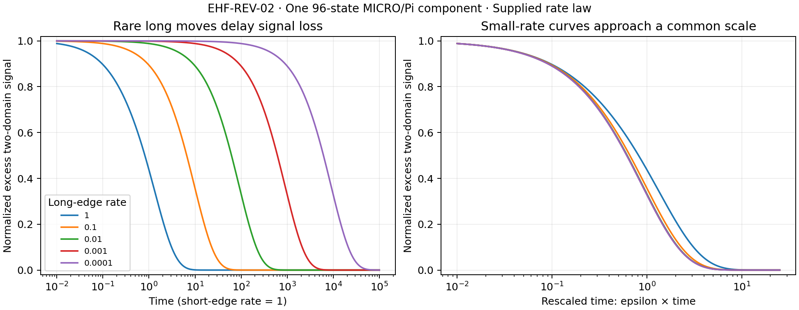

# EHF-REV-02: rare longer channels and persistence

5 November 2026 (Australia/Brisbane). Research direction: Barry Fensom; implementation and analysis assisted by ChatGPT.

**Finding:** a connected MICRO/Pi graph can retain a domain-count signal for a long time when the additional reversal channels are assigned small rates. This is a controlled sensitivity result for a supplied classical Markov process. It does not derive those rates, a memory device or a physical law.

## Question and carrier

[REV-01](../all-length-01/README.md) showed that MICRO does not itself select LR2/LR3. All MICRO-only reversal graphs are connected whenever nonempty. Retaining Pi still allows longer moves to merge some short-move regions and change the domain count. Connectivity establishes eventual accessibility, not a relaxation time.

Fix n=9, bit-1 labels {1,2,3,4}, canonical Pi={0,2,4,6,8}, and the all-length connected component containing C=(0,1,2,3,4,5,6,7,8). This is one component, not the entire Pi-constrained graph or the entire 2,880-state colouring space.

The selected carrier has:

- 96 states: 52 with two domain walls and 44 with four;
- 160 distinct edges obtainable by length-2 or length-3 reversal;
- 88 extra edges of minimal reversal support 4, including 28 wall-changing edges;
- six short-move connected regions: (size, walls) = (40,2), (12,4), (10,4), (12,4), (10,4), (12,2).

Complementary reversals describe the same undirected edge; support means the minimum number of vertices in either segment. Repeated events are collapsed to a distinct state-pair edge, as in REV-01. This convention is explicit: uniform rates per edge need not match uniform rates per attempted reversal event.

## Supplied rate experiment

Use a continuous-time symmetric process with rate 1 on every short edge and epsilon on every extra support-4 edge. The positive graph Laplacian is

\[
L(\epsilon)=L_{23}+\epsilon L_4,
\qquad Q=-L(\epsilon).
\]

Time is measured in units set by the short-edge rate; it is not a physical time calibration. Pi conservation remains an imposed restriction. Epsilon is a parameter we choose, not an output of MICRO.

At epsilon=0, the six regions are disconnected and domain count is exactly retained. At any epsilon>0 the selected graph is connected. Symmetric rates give the uniform stationary distribution, independent of epsilon, so the long-time probability of two walls is 52/96=13/24. Changing epsilon changes kinetics, not that equilibrium distribution.

Initialize uniformly over the 52 two-wall states. Define the normalized excess signal

\[
C(t)=\frac{\Pr(W_t=2\mid X_0\text{ uniform on }W=2)-13/24}{1-13/24}.
\]

Thus C(0)=1 and C(t) tends to 0. The reported half-time is when C(t)=1/2. It is not an assertion of a single exponential decay, and it is different from first exit from the two-wall set.

## Numerical results

| Extra-edge rate epsilon | Signal half-time | Integrated C(t) | Mean first exit from two-wall set |
|---:|---:|---:|---:|
| 1 | 0.81636 | 1.28030 | 2.24105 |
| 0.1 | 6.60719 | 9.82313 | 20.63835 |
| 0.01 | 61.92528 | 91.47901 | 198.62779 |
| 0.001 | 613.26383 | 905.82188 | 1,973.99335 |
| 0.0001 | 6,126.29515 | 9,048.83351 | 19,726.75067 |

These are deterministic finite-matrix calculations, not Monte Carlo estimates. Numerical precision is distinguished from the exact rational first-exit checks below.

The small-epsilon curves approach a common shape when plotted against epsilon*t. The full spectral gap divided by epsilon approaches the gap 1.06157821 of the projected six-region slow Laplacian. At epsilon=0.0001, the ratio is 1.06145833. The smallest positive eigenvalue of the disconnected short-edge Laplacian is 0.19959388, corresponding to an internal spectral relaxation scale about 5.01. These are spectral scales, not universal mixing-time bounds.

The projected slow Laplacian uses columns that are normalized indicators of the six short regions: B^T L4 B. It is the finite-matrix fast-region averaging comparison; no finite-epsilon error bound or universal scaling theorem is claimed here.

## Two useful limits on interpretation

### Edge-change count cannot select the longer-move penalty

Every nontrivial reversal replaces exactly two undirected cycle edges with two others, regardless of support length. The implementation verifies this on the whole selected carrier. A rate rule depending only on the number of replaced edges assigns the same rate to all these moves. It cannot distinguish LR4 from LR2 or LR3.

A physical or structural reason to suppress longer support would require additional assumptions: for example, an explicit mechanism whose cost depends on the participating vertices. Such a mechanism is not constructed in this probe. No energy barrier is inferred from reversal length.

### Domain count is not an exactly closed two-state Markov description

Among the 52 two-wall states, 24 have no direct wall-changing edge and 28 have one. Among the 44 four-wall states, 28 have none, four have one, and 12 have two. Hence instantaneous escape rates vary between states with the same wall count. The partition into W=2 and W=4 is not strongly lumpable at any epsilon>0.

Hidden labelled structure matters for predicting the next domain-count change. This is a precise coarse-description obstruction, not a demonstration of nonclassical memory. The microscopic 96-state process is explicitly Markovian.

## Verification and reproduction

Requires Python 3, NumPy and SciPy; plotting also requires Matplotlib.

    python probe.py
    python verify.py
    python plot.py

- [probe.py](probe.py) constructs the carrier, rates, eigensystem, normalized correlation and first-exit solves. [results.json](results.json) retains every state, both edge sets, all short-region memberships, the numerical results and the probe hash.
- [verify.py](verify.py) imports no probe code. It reconstructs cycles by undirected edge rewiring, neighbour traversal and DFS, and matches the entire 96-state carrier and both edge sets exactly.
- The verifier checks probability evolution at ten time/rate combinations using a direct matrix exponential rather than spectral propagation, and independently checks all five integrated correlation times by a Poisson equation.
- It solves the 52-state killed-generator problem in exact rational arithmetic for epsilon=1 and epsilon=1/1000. The exact mean first-exit values are 121210187/54086292 and 1364886093224644588746173305008223000/691433987475691003547811631021029, respectively.
- [independent-checks.json](independent-checks.json) records the checks and source hashes. [plot.py](plot.py) generates the displayed figure from the retained carrier.

The graph is exact; most dynamic quantities are floating-point calculations checked against independent formulations. No stochastic uncertainty or fitted rates are involved. No external novelty review was performed.

## What to pursue next

This exploration distinguishes permanent protection by forbidden transitions from long persistence caused by rare transitions. Both are possible within the chosen mathematics. It does not explain why either rule should hold.

The next substantive step is to represent a mechanism for channel selection or suppression and measure its effective rates, rather than assign epsilon and regard the resulting persistence as a derivation. A separate writing/readout protocol would also be required before calling the carrier an autonomous memory system.
