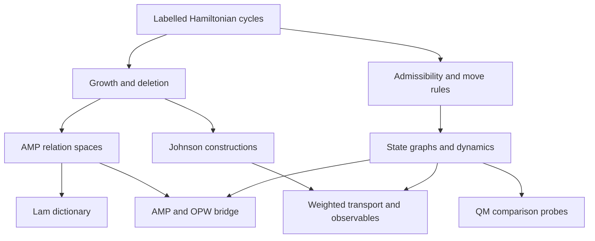

# EHF foundations and connections map 01

4 November 2026. This is a scoped synthesis of the recovered sources and repository work, not a full audit of all EHF branches or a claim that they form one physical theory.

**Starting convention:** Admissible comparison is the chosen primitive data of the framework. The Hamiltonian-cycle representation is a specific mathematical construction within that programme. It must be distinguished from an established physical substrate.

## Organizing structure

Arrows indicate dependencies or the location of a reported bridge, not equal verification status. In particular, the AMP/OPW bridge and Lam dictionary need their own certificates recovered and reproduced. The QM branch contains supplied dynamics and classical controls, not a derived physical quantum theory.

## Four distinctions that keep the programme coherent

1. **State versus move.** Choosing cycle states does not choose reversals, Pi preservation, growth, or rates.
2. **Validity versus selection.** MICRO declares which states are valid. Choosing only LR3, or additionally requiring Pi preservation, further restricts edges between valid states.
3. **Graph versus process.** An unweighted adjacency graph does not choose a stochastic transition law or a quantum Hamiltonian. Event multiplicity, weighting and continuous versus discrete time are additional choices.
4. **Microscopic versus observed.** A projection can hide distinctions or create apparent memory. Moment closure, a graph quotient and strong lumpability are different claims.

## Branches, actual connections and verification boundaries

| Branch | Added structure | Connection to the rest | Current boundary |
|---|---|---|---|
| [RAW v0.19](../source-documents/hc-raw-v0.19.md) | Static HC analysis; optional growth/history layers | RAW-14 already separates structural, growth, historical-coordinate and transport dependencies | Source-reported architecture, not a new full reconstruction here |
| [GROW v0.8](../source-documents/hc-grow-v0.8.md) | Growth/deletion and support channels | GROW-08 discusses several reversal supports and their overlap algebra | Multiple reversal lengths were already studied; the new probe specifically adds MICRO admissibility |
| [OPW23](../source-documents/opw23-v6.md) | Canonical Pi preservation with LR2 and LR3 | Carrier of the recent MICRO/QM finite tests | A chosen rule family; results do not automatically transfer to OPW3 |
| [OPW3 v1.1](../source-documents/opw3-v1.1.md) | Pi preservation with LR3 only | XBR-01 reports a shared growth map with AMP; XBR-03/04 studies its dynamical obstruction and invariant closure | Detailed exact certificates are source-reported and need recovery; closure by construction alone is not a physical explanation |
| [MICRO–OPW](../../probes/qm-bridge/revisit-01/sources/07_micro_opw_01_README.md) | Fixed vertex bits and hard cyclic no-isolation | Restricts OPW state graphs; LR2 can join regions separated under LR3 | Reproduced finite cases; readable component labels do not by themselves supply autonomous memory |
| [All-length reversal audit](../../probes/reversals/all-length-01/README.md) | Every reversal allowed when its endpoint satisfies MICRO, with and without Pi | Directly separates admissibility, support restriction and Pi preservation | New exact finite census, local boundary lemma and general MICRO-only connectivity proof; no rate or physical model |
| [Johnson transport](../source-documents/johnson-transport-original.pdf) | A particular coarser graph/observable description | RAW-14 reports a growth-to-Johnson structural route; stochastic weighting and historical coordinates enter later | Do not equate moment identities with a dynamically closed HC quotient |
| [Curvature](../source-documents/johnson-ollivier-curvature-v1.md) | Chosen walk, shell averaging and metric | Downstream transport geometry | General curvature formula remains open in the supplied note despite finite numerical agreement |
| [AMP and nine-point theorem](../amplitudes/nine-point-tail/README.md) | Ordering relations, parity fibres and signed deletion | Six deletion images inside a common 15D relation space; existing limited independent reconstruction | Reproduction scope is stated in the linked README; not every historical certificate has been reproduced |
| [Lam/XKLT](../source-documents/phys-alg-v0.65.md) | Oriented-matroid topes and intersection/amplitude machinery | XKLT-03 reports an N-point ordering dictionary with M(K_(N-1)); XKLT-04 places the nine-point images in a local amplitude nullspace | Standard Lam/amplitude inputs need credit; no LR3-to-tope adjacency identity follows. Eleven-point 61-node lattice has three-prime checks, not a full rational lift |
| [QM revisits 01–03](../../probes/qm-bridge/README.md) | Supplied coherent control, orientation reference and explicit detector models | Tests what the smaller MICRO–OPW23 graphs actually support | Finite classical controls reproduced; orientation signs do not establish a quantum phase or Born rule |
| [Wheeler synthesis](../wheeler/SUMMARY-01.md) | Particular constrained growth ensembles, symmetry and entropy | Another growth/history branch; connects at the level of assumptions and observables | Its ensemble must be mapped explicitly to GROW before identifying results; consult [errata](../../probes/wheeler/ERRATA-01.md) |

## A recovered bridge worth reproducing next

OPW3 v1.1 reports that the direct AMP image is not generally adjacency-invariant. The XBR-04 continuation enlarges it to its invariant Krylov closure, with 4 zero, 20 proper and 11 full-chamber cases among 35 channels. An example has dimension 54 inside a 216-state chamber. These are much more specific claims than saying that AMP and OPW share orderings.

The useful next reproduction is the explicit growth/deletion map, its first adjacency-invariance failure, and one proper closure. The scientific question is which features of that closure are forced by the construction and stable under changing the admissible moves. No effective quantum law follows just from an invariant subspace of a symmetric matrix.

## What the reversal audit changes

The older GROW document already explores multiple reversal supports, so the broad idea is not new within this archive. The new result addresses a sharper question: whether the MICRO constraint itself selects the restricted move families used in recent probes.

It does not. MICRO-only all-length graphs are connected whenever nonempty. Even retaining Pi, an LR4 can change domain count at nine vertices. Consequently, conservation and fragmentation claims must name both the state constraint and the permitted move family. A general admissibility principle remains a research target, not a recovered unification theorem.

## Priorities after this map

1. Preserve the distinction between source-reported certificates and reproduced results; recover the scripts needed for the OPW3/AMP bridge.
2. If pursuing reversal selection, state the additional principle independently before observing which lengths it allows. Pi conservation, bounded support and rate suppression are different hypotheses.
3. Keep the Lam relation-space presentation focused on the nine-point result while reproducing its dictionary. Do not append quantum-dynamics claims without an explicit construction.

Original source provenance and checksums are recorded in the [source index](../source-documents/README.md). No new literature novelty audit was conducted for this map or the elementary reversal lemmas.
