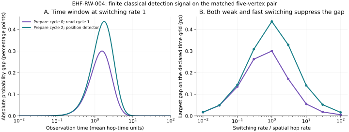

# EHF-RW-004 — Detection strength and simpler observer access

30 October 2026. Follow-up to [RW-003](../2026-10-30-cycle-aware-boundary/README.md).

**COMPUTATIONAL:** the matched five-vertex example has a modest, time-dependent detection signal. A working protocol needs cycle-specific preparation but only position-sensitive readout. At one declared grid point its probability gap is approximately 0.437 percentage points; a prospective 100,000-trial binary test has classification error below 5% under each of the two known model hypotheses. This is a model calculation, not an experiment, a universal reconstruction theorem or evidence of physical quantum behavior.

## Fixed model, inputs and measurement

Use exactly the matched triads A and C retained in RW-003's `moment_checks.json`, with observed positions {0,1,2}, hidden positions {3,4}, spatial hop rate one, and switching rate κ. They share the weighted position graph and immediate cycle-labelled boundary generator. The starting position is always 0.

The generator and input triads are imported from RW-003. Its source and input hashes are retained in [results.json](results.json). We do not change the network or fit its rules to the detection results.

A trial resets the probe independently, prepares its initial label distribution, waits a fixed time t, and records whether a specified boundary detector clicks. Every other outcome, including being outside that detector, is counted as a failure. There is no postselection on returning to the boundary. Arbitrary repeated observations along one correlated trajectory are not independent trials under this calculation.

Unlike the earlier Laplace-integrated response, here we calculate finite-time transition probabilities from exp(−tL). Probabilities are evaluated by symmetric eigendecomposition, checked against independent matrix exponentiation and exact rational resolvents. The underlying process remains classical.

## Declared parameter search and controls

Switching rates are κ=0,0.01,0.03,0.1,0.3,1,3,10,30,100. Observation times are 601 geometrically spaced values from 0.001 to 1000, in units where the mean spatial hop interval is one. Maxima are **on this grid**, not certified continuous optima. Several preparation/readout choices are retained, including pure-label preparation, uniform preparation, cycle-resolved detection and position-only detection at each boundary position.

Settings are selected using theoretical model probabilities. No sampled data are used for tuning. A future empirical check should freeze its protocol before collecting validation observations; the counts below are not corrected for exploratory scanning of experimental data.



The gap vanishes at κ=0, rises to an intermediate-rate window, and decreases again for rapid switching. The largest sampled rate setting for both plotted protocols is κ=1. Very rapid switching averages to the same weighted position generator for the two triads, explaining the loss of the distinction in that limit. Merely increasing the switching rate does not improve access indefinitely.

## Two working protocols

| Protocol | κ | t | Probability under A | Probability under C | Gap in percentage points | Feasible independent trials on the declared count grid |
| --- | --- | --- | --- | --- | --- | --- |
| Prepare cycle 0; detect position 0 in cycle 1 | 1 | 1.54882 | 10.51036% | 10.21015% | 0.30020 | 200,000 |
| Prepare cycle 2; detect position 2 irrespective of final label | 1 | 1.73780 | 18.05749% | 17.62058% | 0.43691 | 100,000 |

The second detector does not identify cycle labels. Cycle 2 is identifiable from the immediate observed links: it is the cycle containing boundary edge {0,2}, while cycles 0 and 1 each contain boundary edges {0,1} and {1,2}. This preparation choice is invariant under the remaining ambiguity of exchanging cycle names 0 and 1. It still assumes the ability to prepare that cycle at position 0; the model does not derive that control from an internal observer mechanism.

The earlier fully position-only observer **both prepared a uniform mixture of labels and ignored the final label**. Its indistinguishability result is consistent with this test: changing the initial preparation gives the observer additional access even if the detector itself stays position-only.

At κ=1, uniform initial labels with cycle-sensitive readout also produce a smaller signal. Thus these calculations do not require both selective preparation and resolved readout simultaneously. They do require some cycle-sensitive access. Uniform preparation combined with position-only readout produces no detectable signal over the computed grid; RW-003's selected-pair moment check already certifies equality of the complete such responses at its tested rates.

## What the sampling numbers mean

For a chosen detector, each trial is Bernoulli with probability p_A or p_C. These are two specified simple hypotheses with known generator parameters, preparations and detector behavior. We choose a count threshold and require **both** the false-A and false-C probabilities to be at most 0.05.

For the simpler protocol, N=100,000 and threshold 17,820 work: declare A when at least 17,820 clicks are observed, otherwise declare C. Direct binomial-tail calculations give:

- Under C: probability of incorrectly declaring A ≈0.04952.
- Under A: probability of incorrectly declaring C ≈0.02506.

These are classification error probabilities, not a claim of a 95% posterior probability or a confidence interval. Trial counts are the first feasible values on the declared 1–2–5 grid up to 5 billion; no minimum-sample-size or statistical optimality claim is made. Full outcome histograms or more sophisticated protocols were not optimized.

A separate conservative check uses a midpoint threshold. Hoeffding's one-sided inequality gives an error bound exp(−N Δ²/2) under either hypothesis, where Δ=|p_A−p_C|. Hence N≥2 log(1/0.05)/Δ² suffices. This gives 313,870 trials for the simpler protocol and 664,827 for the original channel; its larger counts reflect a distribution-free bound, not a discrepancy in the binomial calculation.

No Monte Carlo trials were actually conducted. These are prospective design calculations from numerically computed probabilities. They assume independent resets, exact knowledge of the two alternatives, calibrated rates and observation time, and no unspecified systematic detector drift. Model mismatch, unknown preparation error, reset costs and physical implementation can dominate this small gap. Observation time is in model units, not seconds of a real apparatus.

## Preparation and readout imperfections

For the simpler protocol, with probability ε replace intended cycle-2 preparation by a uniform label draw; position detection remains perfect. Keep κ and t fixed at the selected operating point.

| Preparation replacement ε | Gap (percentage points) | Feasible trials on count grid |
| --- | --- | --- |
| 0 | 0.43691 | 100,000 |
| 0.1 | 0.39322 | 200,000 |
| 0.3 | 0.30584 | 200,000 |
| 0.5 | 0.21846 | 500,000 |
| 1 | 0 within numerical precision | No distinction for this observer |

The gap scales as 1−ε here because the uniformly prepared position response is identical. A replacement probability of 0.1 does not mean a 10% probability of the wrong label: a replacement can randomly select the intended label again. The count grid is coarse, explaining the equal count at ε=0.1 and 0.3.

The original label-to-label protocol is also tested with preparation replacement ε and readout replacement η. In the latter, with probability η, replace the measured label by a uniformly drawn label; positions remain accurately detected. A 5×5 grid is retained. The signal weakens under these declared noise models, but these tests do not cover arbitrary noise or unknown systematic bias.

## Verification and reproducibility

Files:

- [probe.py](probe.py): probabilities, access controls, binomial design, noise tests and validation.
- [results.json](results.json): all parameter settings, maxima, probabilities, trial thresholds, error probabilities, hashes and validation summaries.
- [draw.py](draw.py): regenerates the scientific figure from the same model and saved protocol.
- [signal.svg](signal.svg): two-panel figure, with gaps expressed in percentage points.

Requires Python 3, NumPy, SciPy and Matplotlib (the last only for the figure). Numerical run: NumPy 2.3.5, SciPy 1.17.0. The imported RW-003 probe also imports RW-002's standard-library enumeration and exact inversion. Keep these repository directories together.

```bash
OPENBLAS_NUM_THREADS=1 OMP_NUM_THREADS=1 python3 research/related-work/2026-10-30-detection-access/probe.py
OPENBLAS_NUM_THREADS=1 OMP_NUM_THREADS=1 python3 research/related-work/2026-10-30-detection-access/draw.py
```

Checks cover 60 independent matrix-exponential comparisons, stochastic normalization and nonnegativity, spectral versus rational resolvents at all ten rates, and rational scalar access measurements at κ=0,0.1,1,10. Gaps at the scale of floating-point roundoff are reported as undetectable at the declared numerical resolution, not promoted into signals. Probabilities and sampling plans are floating-point computations; the exact all-rate identity from RW-003 is not reclassified as a measured signal here.

## Assessment and contribution back

This follow-up improves the observer specification: selective cycle preparation can suffice with a simple position detector. It also limits the practical interpretation. The effect is small in a five-vertex toy example and needs substantial independent sampling under idealized calibration. It is useful as a controlled benchmark; it does not yet justify a broad size sweep, an experimental proposal or a general EHF emergence claim.

The generator/resolvent and boundary-reduction background retains the attribution in RW-002 and RW-003, including Dörfler and Bullo; the earlier holography motivation credits Pasterski, Pate and Raclariu. Standard Bernoulli testing and Hoeffding's inequality are used here, with the bound derived above. The original reference is Wassily Hoeffding, *Probability Inequalities for Sums of Bounded Random Variables*, Journal of the American Statistical Association 58(301), 13–30 (1963), [DOI:10.1080/01621459.1963.10500830](https://doi.org/10.1080/01621459.1963.10500830). Its publisher bibliographic record was consulted on 30 October 2026; the full original proof was not reviewed. Code and analysis were developed with AI assistance. No broader literature or novelty assessment was undertaken.

**Potential contribution back:** retain the complete matched benchmark and its access/noise specification as a possible reproducible example for layered-network observability research. Check existing observability and statistical discrimination literature before proposing it as novel. Nothing is ready for outreach; no researcher was contacted.

**Decision:** preserve this result and pause larger sweeps. Further work should first justify an internal observer's cycle preparation/readout or test robustness to a specifically motivated restriction, rather than adding arbitrary control capabilities.
